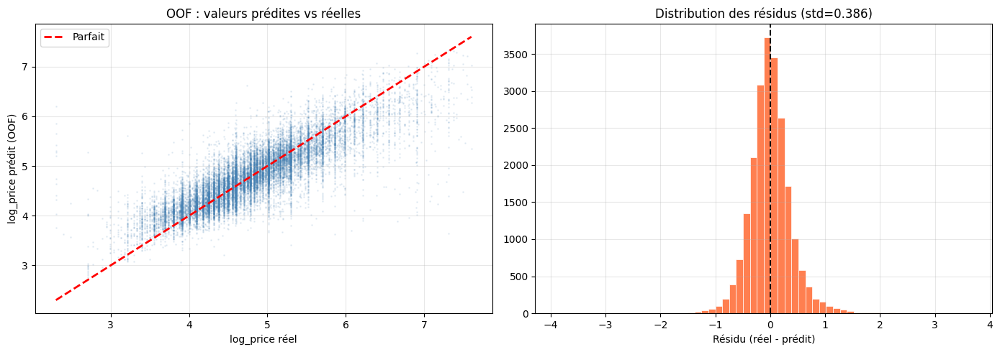
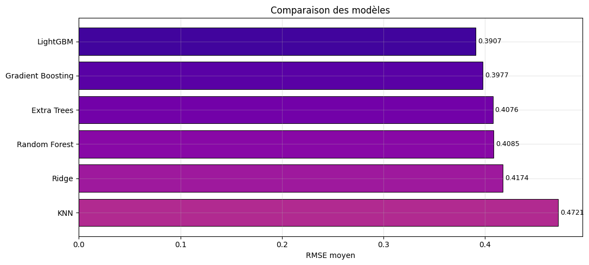

# Airbnb Price Prediction

Regression project predicting the **price per night** of Airbnb listings from their characteristics (location, property type, size, host information, reviews, amenities).

**Best model:** LightGBM, **RMSE 0.386 ± 0.010 on log(price)** in 5-fold cross-validation.



## Data

| | Listings | Columns |
|---|---|---|
| Train (price known) | 22,234 | 28 |
| Test (price to predict) | 51,877 | 27 |

The target is `log_price`, the logarithm of the nightly price: it makes the heavily right-skewed price distribution close to normal. The datasets are not included in this repository.

## Approach

1. **Exploratory analysis**: missing values, price by city and property type, correlations, impact of amenities and boolean features
2. **Feature engineering**: missing-value indicators (e.g. listings without reviews yet), host seniority, the 35 most frequent amenities turned into binary columns
3. **Encoding**: out-of-fold target encoding with smoothing for high-cardinality columns (neighbourhood, zip code), label encoding for the others → 65 features
4. **Model selection**: six models compared on the same features, then feature groups added one at a time to measure their contribution
5. **Final model**: LightGBM with 5-fold cross-validation and early stopping, retrained on the full training set
6. **Diagnostics**: feature importance, out-of-fold predictions vs actual values, residual distribution

## Results

Model comparison (3-fold CV, RMSE on log price, lower is better):

| Model | RMSE |
|---|---|
| **LightGBM** | **0.391** |
| Gradient Boosting | 0.398 |
| Extra Trees | 0.408 |
| Random Forest | 0.409 |
| Ridge | 0.417 |
| KNN | 0.472 |

Contribution of feature groups (LightGBM):

| Features | RMSE |
|---|---|
| Base (size, location) | 0.434 |
| + categorical variables | 0.403 |
| + amenities/services | 0.393 |
| All features | 0.391 |

The final LightGBM reaches an RMSE of **0.386 ± 0.010** over 5 folds. The most important features are the room type, location (neighbourhood, zip code, GPS coordinates) and size (bathrooms, bedrooms, capacity). Residuals are centred on zero; the model is less accurate on very cheap and very expensive listings.



## How to run

```bash
python -m venv .venv
source .venv/bin/activate        # Windows: .venv\Scripts\activate
pip install -r requirements.txt
jupyter notebook airbnb_price_prediction.ipynb
```

Place `airbnb_train.csv` and `airbnb_test.csv` next to the notebook. The notebook writes its predictions to `predictions.csv`.

**Note:** the notebook comments and analysis are written in French.

## Repository structure

```text
.
├── airbnb_price_prediction.ipynb   # full analysis and model
├── requirements.txt
└── figures/                         # key figures exported from the notebook
```

## Tech stack

Python · Pandas · NumPy · scikit-learn · LightGBM · Matplotlib · Seaborn · Jupyter

## Authors

**Noé Payan** and **De Rouvre** — Engineering students in Data & Artificial Intelligence, ESILV (Paris)
